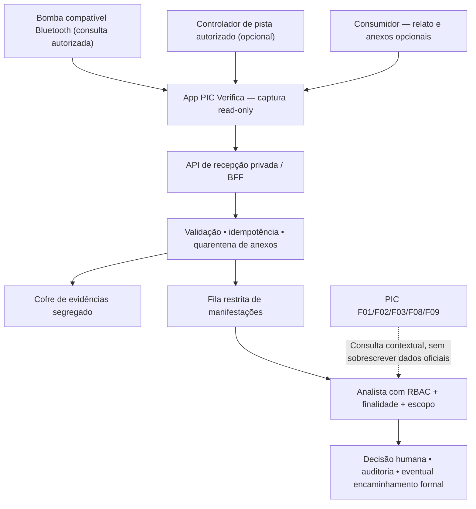

# Contrato conceitual — evidências de bomba e manifestações

**Estado:** especificação futura, sem API ou schema implementado. **Versão:** proposta 0.1 — 12/11/2026.

## 1. Fronteiras e provenance

**Tipos de dado:** `oficial`, `observacao_instrumento`, `declaracao_usuario`, `analise_humana`, `comunicacao_ao_orgao`. Nunca transformar tipos automaticamente. O `posto_id` conecta contextos **após** vinculação verificada; `data`, produto e posição geográfica não identificam sozinhos transação, amostra PMQC e estabelecimento.

## 2. Modelo de observação de instrumento (proposto)

| Campo | Semântica |
| --- | --- |
| `observacao_id`, `schema_version` | Identificador interno e contrato |
| `fabricante`, `modelo`, `versao_firmware?`, `protocolo`, `perfil_transporte` | Atributos de compatibilidade; não inventar campo ausente |
| `instrumento_identidade`, `posto_id?`, `vinculo_justificado` | Associação validada, inclusive negativa/pendente |
| `evento_instrumento_id?`, `tempo_evento?`, `tempo_recebimento_utc` | Tempo do equipamento e do app separados; clock drift declarado |
| `volume_informado?`, `produto_informado?`, `valor_informado?`, `unidades` | Informação **declarada pela bomba**, não medição física independente |
| `pacote_raw_ref`, `sha256`, `assinatura_estado`, `certificado_referencia?` | Prova de recebimento, autenticidade verificável e incerteza |
| `origem_permissao`, `versao_adaptador`, `falhas[]` | Autorização, reprodutibilidade e erro |

`assinatura_estado`: `valida`, `invalida`, `nao_verificada`, `nao_suportada`, `erro`. **Assinatura válida não confirma entrega física.**

## 3. Modelo de manifestação (proposto)

`manifestacao_id` (privado) e `protocolo_publico` (opaco), `posto_id?` + `vinculo_estado`, `categoria_relato`, `data_evento_aproximada`, `descricao`, `observacao_id?`, `anexos[]` com hash/varredura, `reportante_ref?` segregado, `estado`, `responsavel`, `historico_de_atuacoes`, `nivel_visibilidade`, `politica_retencao`.

**Endpoints hipotéticos, não existentes:**
- `POST /v1/manifestacoes` — submissão pública controlada de denúncia, controles antiabuso, token/protocolo de retorno; **não** via API pública de fatos.
- `GET /v1/manifestacoes/protocolo/{token}` — consulta minimizada do próprio status, exigir controle contra enumeração.
- `GET /v1/gestao/manifestacoes` — fila **restrita** com RBAC/ABAC, escopo, finalidade e auditoria inclusive de leitura.
- `POST /v1/gestao/manifestacoes/{id}/decisoes` — triagem humana com justificativa e transição permitida.
- `POST /v1/gestao/manifestacoes/{id}/encaminhamentos` — processo de transferência autorizado, sem automatismo.

**Exclusões:** publicação automática na ficha, score, upload público de denúncias, acesso irrestrito por posto, compartilhamento de dados pessoais a parceiros, comando de controle da bomba.

## 4. Invariantes e testes obrigatórios

1. Envio de relato **sem Bluetooth** sempre possível; erro de comunicação não impede o formulário.
2. Dado enviado pelo app mantém **origem e natureza**: declaração do usuário não vira evento metrológico oficial.
3. Falha de assinatura ≠ comprovação de fraude; sinalizar e escalar para avaliação.
4. Operações de leitura metrológica só com compatibilidade, autorização e isolamento de comandos.
5. Relato armazenado em domínio privado, com criptografia, quarentena de anexos e metadados mínimos.
6. `GET` do protocolo exibe somente estado permitido ao titular; acesso a caso alheio gera negação e auditoria.
7. Uma conta de posto, parceiro ou administrador técnico **não** vê fila ou conteúdo por padrão.
8. Só o perfil habilitado, escopo e finalidade válidos podem ver, atribuir, exportar e encaminhar; concessão expirada bloqueia leitura.
9. Revogação, retenção, incidentes e exercício dos direitos do titular documentados em RIPD e contratos antes do piloto.
10. Nenhum evento de manifestação aciona sozinho autuação, bloqueio de bomba, alerta público ou mutação das bases oficiais.

## 5. Decisões pendentes
Fabricante/modelo e especificação efetiva da interface NIT-Sinst-020; perfil Bluetooth (SPP vs BLE); base legal/controlador; política de anon./confidencialidade; período de retenção; quem pode analisar e encaminhar; prazos de atendimento; consulta de protocolo; licenças/contratos com fornecedores.

**Referências:** [Portaria Inmetro 227/2022](https://www.ipem.pr.gov.br/sites/default/arquivos_restritos/files/documento/2022-06/portaria_227_26_05_2022_bombas_medidoras_nova_julho_2022.pdf), [catálogo normativo Inmetro (software)](https://www.gov.br/inmetro/pt-br/assuntos/metrologia-legal/documentos-normativos-para-metrologia-legal/assunto/software) para NIT-Sinst-020, [NIT-Dmtic-009 (certificados)](https://www.gov.br/inmetro/pt-br/assuntos/metrologia-legal/certificacao-digital), [IFSF](https://www.ifsf.org/) para avaliar integrações autorizadas com controladores. Confirmar versão vigente, permissões e compatibilidade de cada modelo **antes de implementar**.
